# 松间叩仙

一款前后端分离的国风文字修仙 RPG。项目以 Web 端为主要体验，围绕修炼、突破、游历、战斗、功法、装备、炼丹、炼器、坊市和社交构建完整成长闭环，并提供独立后端、PostgreSQL 数据层与 Windows 运营管理台。

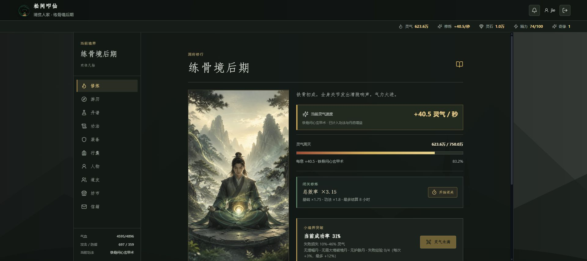

## 项目特点

- 完整修仙成长：49 个小境界，支持自然修炼、闭关、突破、失败补偿与大境界跌境机制。
- 内容驱动玩法：1305 本功法、919 种物品、260 件武器、130 件护器与 390 张器谱。
- 探索与战斗：13 个游历区域、134 条随机事件、39 名征伐敌人，包含精力、伤势、战报和首领门槛。
- 生产与经济：炼丹、炼器队列，材料来源追踪，系统商店、玩家拍卖与交易信箱。
- 社交系统：玩家搜索、好友申请、世界传音、好友私聊。
- 多端架构：React Web 主客户端、Express API、PostgreSQL、实验性微信小程序客户端和 Windows 管理台。
- 服务端可信：掉率、战斗、突破、库存和交易结算均由后端执行，关键写操作使用事务和幂等保护。

## 功能截图

### 修炼、闭关与突破

自然修炼与闭关互斥，灵气达到上限后停止增长；突破会根据境界、丹药和失败经验计算成功率与惩罚。


### 游历、随机事件与战斗

区域拥有独立精力消耗、主要产物与遭遇池。随机遭遇支持迎战、避开、调息和战绩查询。

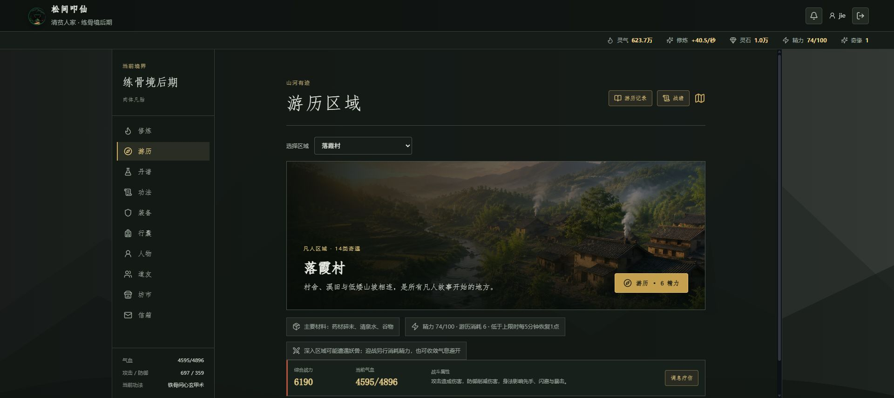

### 丹谱与炼丹

丹谱支持品质筛选、搜索、材料校验、炼制队列和成品领取。

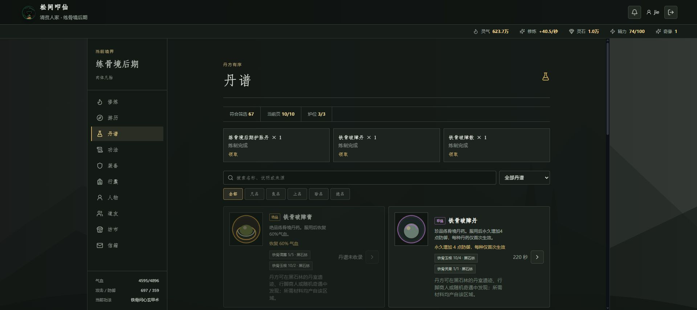

### 功法

功法按境界与品质组织，可检索、解锁并切换主修；主修品质会影响修炼效率和大境界成长。

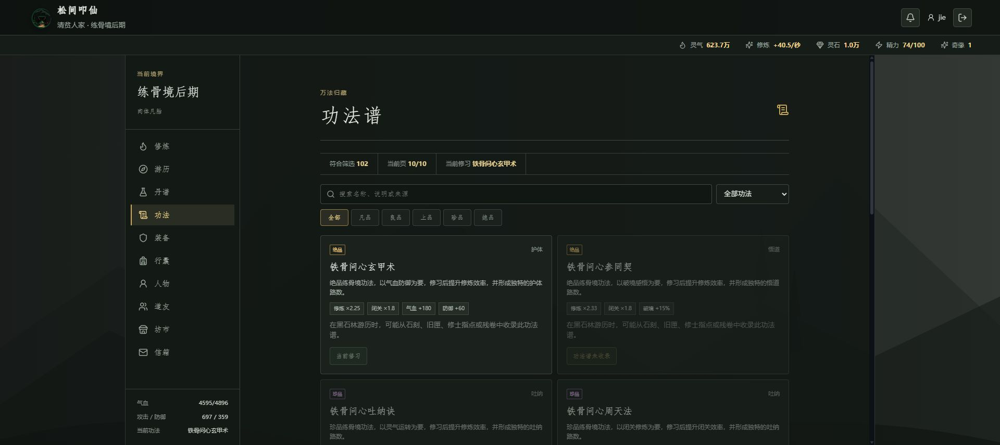

### 装备与炼器

攻器位和护器位各可装备一件器物，属性参与战斗；器谱支持材料校验、炼制队列和领取。

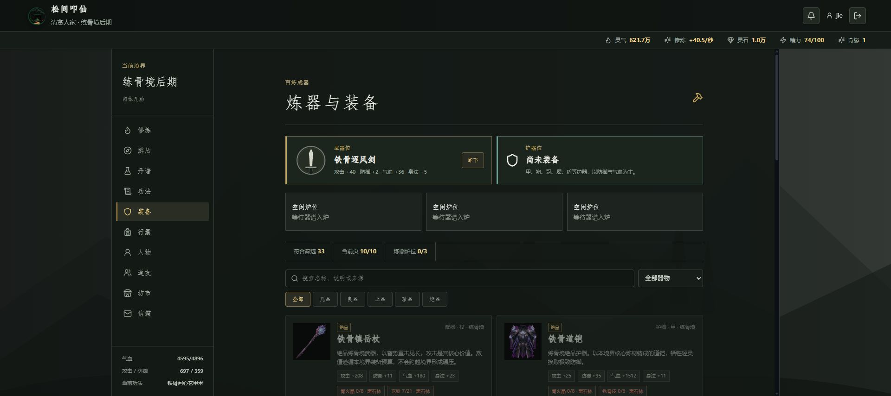

### 行囊

统一管理材料、丹药和器物，支持使用、锁定、装备、卸下、回收和分解。

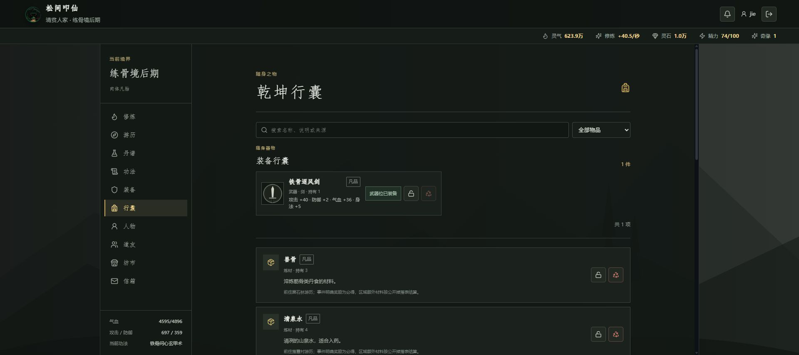

### 人物

展示完整角色立绘、出身、境界、称号、基础属性和当前成长状态。

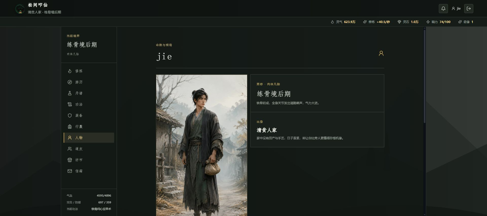

### 道友与传音

支持玩家搜索、好友申请、世界频道和好友私聊。

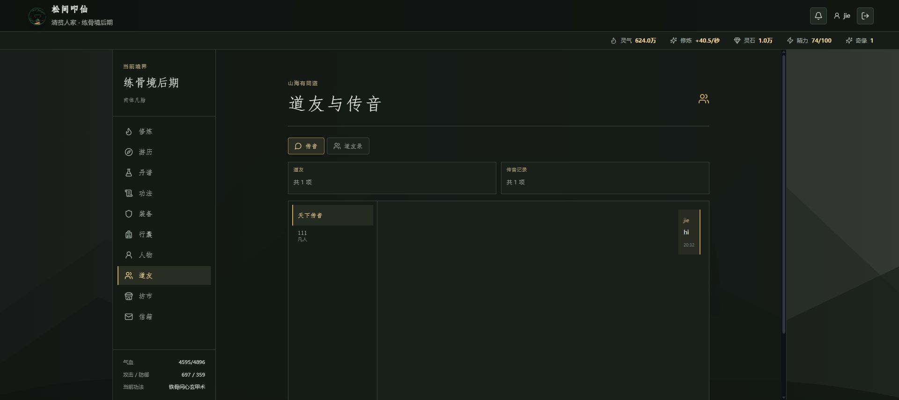

### 坊市与拍卖

系统商店提供基础物资，玩家可自主定价上架物品或器物，并通过事务完成购买和撤拍。

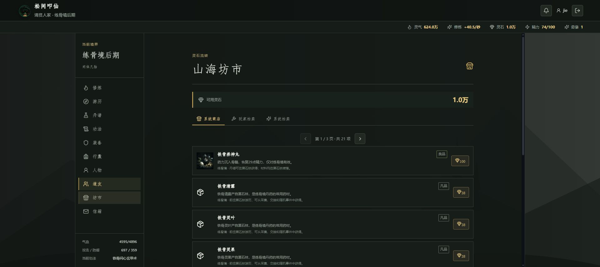

### 信箱

交易所得、撤拍物品和系统奖励通过信箱附件交付，领取操作具备事务保护。

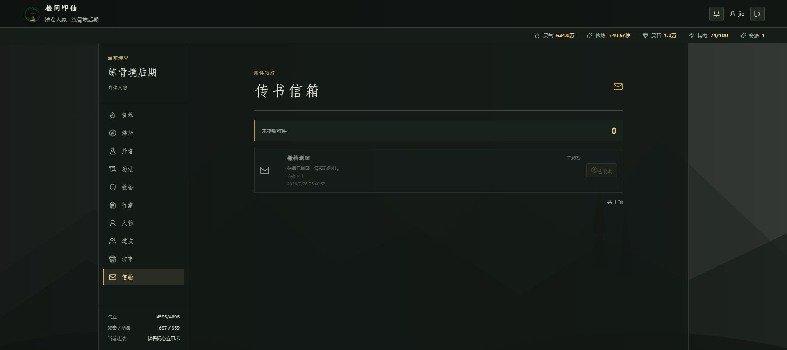

### 运营管理台

Windows 管理台提供运营总览、玩家管理、邮件、聊天审核、拍卖、公告、内容配置和审计记录。

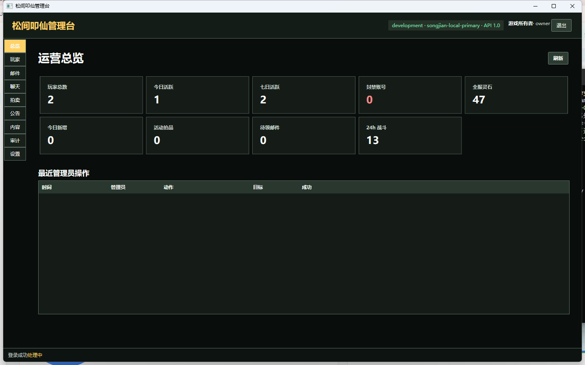

## 系统架构

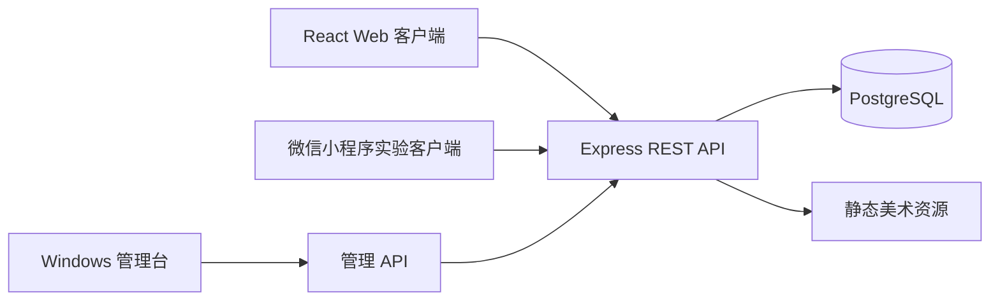

| 模块 | 技术 |
| --- | --- |
| Web 前端 | React 18、Vite 5、Zustand、Axios、Lucide React |
| 后端 | Node.js 20、Express 4、JWT、Helmet、Rate Limit |
| 数据库 | PostgreSQL 16、SQL Migration |
| 微信客户端 | 原生微信小程序，当前为实验性客户端 |
| 管理台 | .NET 8、WPF、WebView2 |
| 部署 | Docker、Docker Compose、Nginx |

## 项目目录

```text
songjian-cultivation/
├── frontend/                  # React Web 主客户端
├── backend/                   # Express API、迁移、测试和服务端美术资源
├── admin-tool/                # Windows 运营管理台
├── miniprogram/               # 实验性微信小程序客户端
├── docs/                      # 部署文档、设计记录与项目截图
├── scripts/                   # Windows 本地开发启停脚本
├── docker-compose.yml         # Web + API + PostgreSQL 完整部署
├── docker-compose.backend.yml # 独立后端部署
├── GDD.md                     # 游戏设计文档
└── README.md
```

## 快速开始

### 环境要求

- Node.js 20+
- npm 10+
- PostgreSQL 16+，或 Docker Desktop / Docker Engine
- 构建管理台时需要 .NET 8 SDK 和 Windows

### 1. 获取代码并安装依赖

```bash
git clone https://github.com/alikatong/songjian-cultivation.git
cd songjian-cultivation

cd backend
cp .env.example .env
npm install

cd ../frontend
npm install
```

Windows PowerShell 可使用：

```powershell
Copy-Item backend/.env.example backend/.env
```

### 2. 配置环境变量

编辑 `backend/.env`：

| 变量 | 说明 |
| --- | --- |
| `DB_HOST` / `DB_PORT` | PostgreSQL 地址与端口 |
| `DB_NAME` / `DB_USER` / `DB_PASSWORD` | 数据库与受限应用账号 |
| `DB_SSL` | 远程数据库需要 SSL 时设为 `true` |
| `DB_SCHEMA` | 应用使用的独立 Schema，默认 `xxgame` |
| `JWT_SECRET` | 玩家 JWT 密钥，生产环境至少 64 位随机字符串 |
| `ADMIN_JWT_SECRET` | 独立的管理端 JWT 密钥 |
| `CLIENT_ORIGIN` | 允许访问 API 的 Web 来源 |
| `WECHAT_APP_ID` / `WECHAT_APP_SECRET` | 仅实验性小程序登录需要 |

不要提交真实 `.env`、数据库口令或微信密钥。

### 3. 初始化数据库

```bash
cd backend
npm run migrate
```

迁移器会创建数据表并写入境界、功法、物品、器物、区域、事件与敌人等基础内容。受限数据库账号可通过 `DB_SCHEMA=xxgame` 使用自己拥有的独立 Schema。

### 4. 启动开发环境

```bash
# 终端 1：后端 http://localhost:3001
cd backend
npm run dev

# 终端 2：Web 前端 http://localhost:5173
cd frontend
npm run dev
```

Windows 也可以在项目根目录运行：

```powershell
.\scripts\start-dev.ps1
```

停止本地服务：

```powershell
.\scripts\stop-dev.ps1
```

## Docker 部署

### 完整部署

完整模式包含 PostgreSQL、后端 API 和 Nginx Web 前端：

```bash
cp .env.example .env
# 编辑 .env，设置数据库密码和 JWT 密钥
docker compose up -d --build
docker compose logs -f
```

启动后通过 `http://服务器地址` 访问 Web 端。

### 仅部署后端

已有远程 PostgreSQL，或需要给独立客户端提供 API 时：

```bash
cp backend/.env.example backend/.env
docker compose -f docker-compose.backend.yml up -d --build
```

生产环境应通过 Nginx、Caddy 或云负载均衡提供 HTTPS。详细说明见 [后端与小程序部署文档](docs/deployment/backend-and-miniprogram.md)。

## 管理台

先创建管理员账号：

```bash
cd backend
npm run admin:create -- owner "至少12位强密码" "游戏所有者" owner
```

构建 Windows x64 管理台：

```powershell
dotnet build admin-tool/SongJian.AdminTool/SongJian.AdminTool.csproj -c Release -p:Platform=x64
```

管理台默认连接 `http://127.0.0.1:3001`。所有管理写操作要求填写原因与幂等键，并记录不可变审计日志。

## 实验性微信小程序

`miniprogram/` 保留原生微信小程序客户端，目前不是项目主展示端。使用前需要修改：

- `miniprogram/config/env.js` 中的 API 与静态资源地址。
- 微信公众平台的服务器域名白名单。
- 生产环境 HTTPS 证书与合法域名。

个人主体或未开通手机号能力的账号可使用普通账号登录流程。

## 主要 API

| 模块 | 主要接口 |
| --- | --- |
| 认证 | `POST /api/auth/register`、`POST /api/auth/login` |
| 角色 | `GET /api/character`、`POST /api/character/create`、`POST /api/character/breakthrough` |
| 修炼 | `POST /api/game/retreat/start`、`POST /api/game/retreat/end` |
| 游历战斗 | `POST /api/game/explore`、`POST /api/game/pve/fight`、`POST /api/game/pve/avoid` |
| 炼丹炼器 | `POST /api/game/craft`、`POST /api/game/forge` 及对应领取接口 |
| 行囊装备 | `/api/game/items/*`、`/api/game/equipment/*`、`/api/game/techniques/equip` |
| 社交 | `/api/social/friends/*`、`/api/social/messages` |
| 坊市信箱 | `/api/market/shop/*`、`/api/market/auction/*`、`/api/market/mail/*` |
| 管理 | `/api/admin/*` |

## 测试与检查

```bash
cd backend
npm test
npm run smoke

cd ../frontend
npm run build
```

只读检查内容覆盖率：

```bash
cd backend
node scripts/verify-content.js
```

当前自动化测试覆盖认证、离线收益、突破、战斗、分页、好友消息、微信服务和数据库迁移等关键逻辑。

## 安全说明

- `.env`、日志、依赖目录和构建产物已加入 `.gitignore`。
- 玩家与管理端使用不同 JWT 密钥和鉴权链路。
- 管理操作采用角色权限、原因记录、幂等键和审计日志。
- 生产环境必须更换示例密钥、启用 HTTPS，并使用权限受限的数据库账号。
- 不要将数据库、管理端或开发调试端口直接暴露到公网。

## 设计文档

玩法数值与系统设计参见 [GDD.md](GDD.md)。部署细节与管理台设计记录位于 [docs/](docs/)。

## License

当前仓库未附带开源许可证，默认保留所有权利。若计划开放二次开发或商业使用，请先补充明确的许可证文件。
